# RadioVerum board: user guide

The RadioVerum board shows **where you are inside a building**, using only the Wi-Fi signals around it. With the RadioAtlas Capture app it can also **record Wi-Fi data** to build new maps.

It needs a 2.4 GHz Wi-Fi network with Internet: eduroam, a phone hotspot or a home router. You need your phone only for the first setup and for recording.

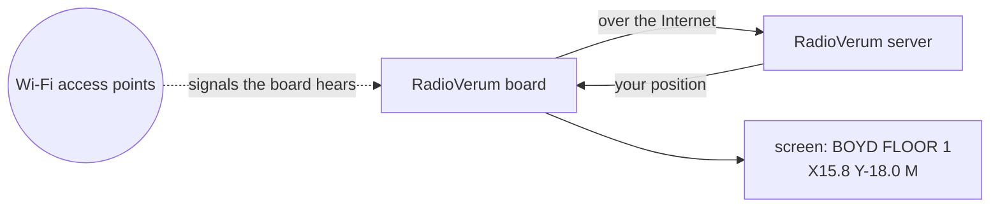

**Contents:** [1 The board](#1-the-board) · [2 Two modes](#2-two-modes) · [3 First setup](#3-first-setup) · [4 Reading the screen](#4-reading-the-locate-screen) · [5 Map](#5-see-yourself-on-a-map) · [6 Recording](#6-record-data-collect) · [7 Updates](#7-update-the-firmware) · [8 Problems](#8-if-something-is-wrong) · [9 Questions](#9-questions)

---

## 1. The board

| Part | What it does |
|---|---|
| Front button (below the screen) | **Press 3 times quickly**: switch mode. **Hold about 2 s**: check for an update |
| USB-C | Charging, and the cable to your phone |
| Battery | Shown at the top (`CHG` while charging). Lasts hours, not days: charge it every day you use it. It works while plugged in |

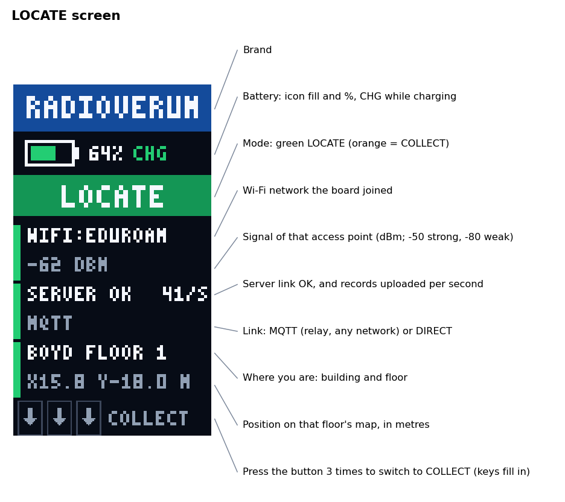

The coloured bar next to each block: **green** working, **yellow** waiting, **red** not set up, **grey** not used in this mode.

---

## 2. Two modes

| | **LOCATE** (green) | **COLLECT** (orange) |
|---|---|---|
| For | seeing your position | recording data with the Capture app |
| Needs | Wi-Fi with Internet | your iPhone on the USB cable, app open |
| Uses Wi-Fi | yes, sends data to the server | no, only listens; data goes to the phone |

**To switch, press the button 3 times quickly** (less than a second apart). Each press fills one key at the bottom. On the third press the board restarts in the other mode. Too slow? The keys empty again; start over. The board remembers its mode when switched off.

| | | | |
|:-:|:-:|:-:|:-:|
| 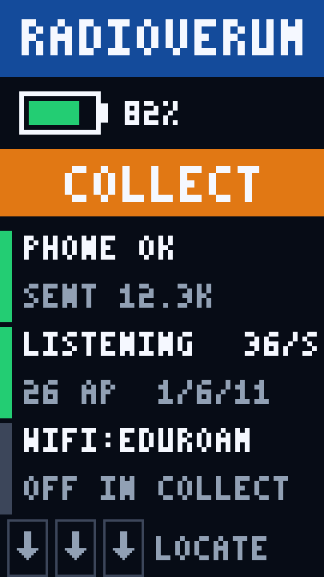<br/>COLLECT | 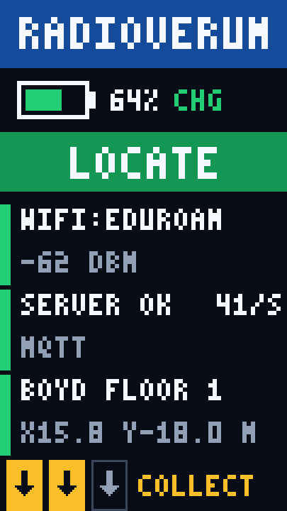<br/>2nd press | 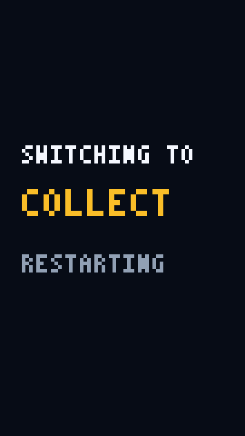<br/>3rd press: switching | 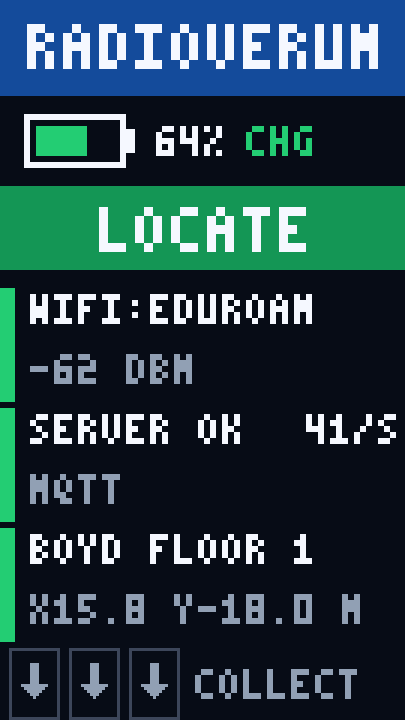<br/>LOCATE |

---

## 3. First setup

**A new board** (bought from M5Stack, not set up by us) needs our firmware first: [flash it yourself](#71-flash-it-yourself-usb), about 5 minutes. Then:

Do this once per board, or when you change networks. You need an iPhone with USB-C (iPhone 15 or newer), a Mac or a Linux computer (Windows has no driver for the board's network), a USB-C cable, and your eduroam login (e.g. `yourid@uga.edu`) and password.

1. Plug the board into the phone (or computer). It sees the board as a wired network; there is nothing to accept.
2. Open **Safari** (or any browser) at **`192.168.7.1`** and tap the **Settings** tab. (The page title still says *RadioAtlas CSI*.)
3. Tap **Scan**, wait about 3 s, and tap **eduroam**. *Security* changes to *WPA2-Enterprise / eduroam (PEAP)* by itself.
4. **Username**: your full login, e.g. `yourid@uga.edu`. Leave *Identity* empty. **Password**: yours. Once saved, the field stays empty (*saved, leave empty to keep*).
5. **Server URL**: leave it as it is. **Name on the live map**: something you recognise, e.g. `Alice's board`. Leave *Access token*, *CSI* and *Roaming* alone.
6. Tap **Save and reboot**, then unplug the phone.

| | |
|:-:|:-:|
| 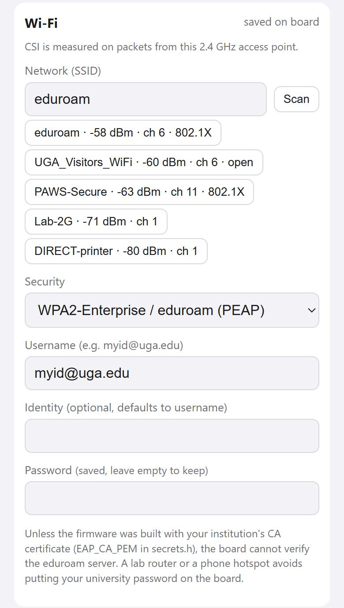 | 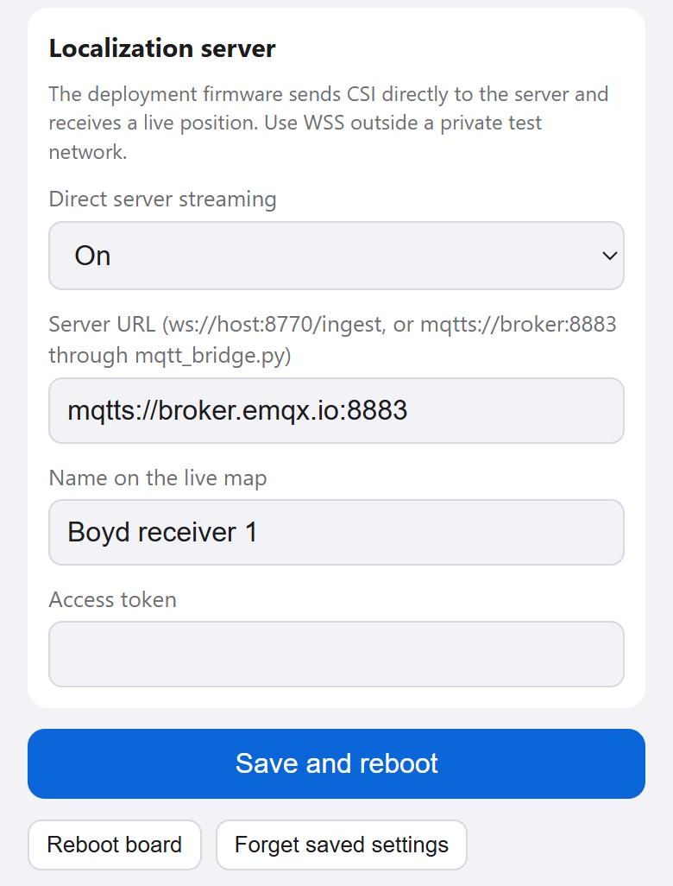 |

> The board only uses **2.4 GHz**. A network missing from the scan may be 5 GHz only. For a phone hotspot, turn on **Maximize Compatibility**, pick it in the scan, choose *WPA2 / WPA3 Personal* and enter the hotspot password.

What you should see next, in LOCATE (if the band is orange, press 3 times):

| | | | |
|:-:|:-:|:-:|:-:|
| 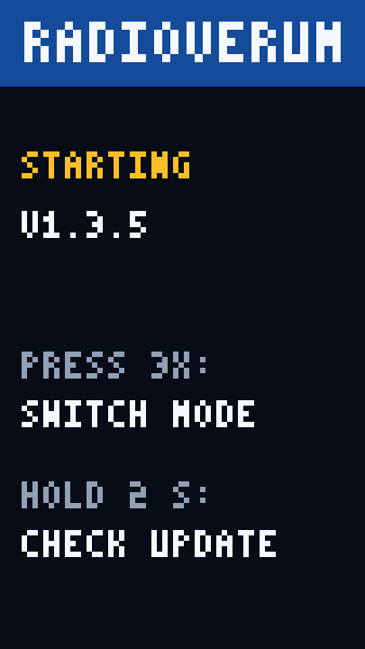<br/>starting | 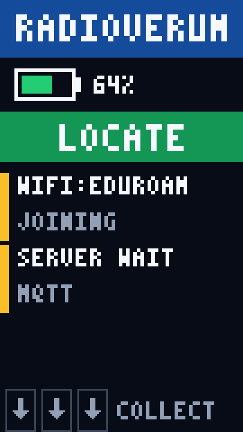<br/>joining Wi-Fi | 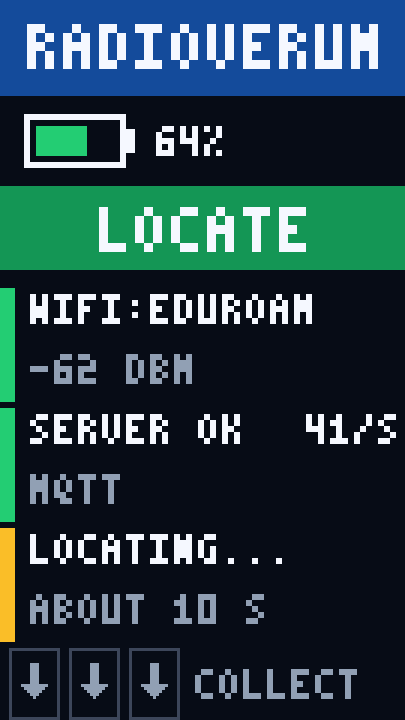<br/>first position in ~10 s | <br/>**done** |

---

## 4. Reading the LOCATE screen

| Screen text | Meaning |
|---|---|
| `WIFI:EDUROAM` · `-62 DBM` | Network and signal: −50 is strong, −80 is weak. `JOINING` while it connects |
| `SERVER OK` · `41/S` | Sending about 41 Wi-Fi readings per second. `SERVER WAIT` while it connects |
| `MQTT` | Normal: data travels over the Internet through a public relay. It is **not encrypted**: do not rely on it where privacy matters |
| `MQTT ENCRYPTED` | Older firmware (1.3.6). Works; to update it, [flash it over USB](#71-flash-it-yourself-usb) |
| `DIRECT` | Straight to our server; only on UGA's network |
| `LOCATING...` · `ABOUT 10 S` | Waiting for the first position |
| `BOYD FLOOR 1` · `X15.8 Y-18.0 M` | Building, floor, and your position on the floor map in metres. Updates several times a second |

Tips:
- Carry the board in your hand or clipped on, not in a closed metal box.
- Positions only make sense where we have a map (today: Boyd, floor 1).
- Walking between access points is fine. The board switches to a stronger one in about 0.1 s without losing data.

---

## 5. See yourself on a map

- **At UGA**: on UGA's network, open **`http://172.22.168.58:8770/`** (add `?lang=en` for English). Pick your board's name in the list at the top right to see your position, trail and heat map.
- **Anywhere else**: run our server program on your own computer. Ask us for the kit (one zip: program, map and model; no key needed); its README has the steps. It shows the board on the map, either computing positions itself or showing the ones our server sends back.

---

## 6. Record data (COLLECT)

Only needed if you help us map a new place.

1. Press the button 3 times to get to **COLLECT** (orange).
2. Plug the board into the iPhone and open **RadioAtlas Capture**. The board shows `PHONE OK`, and `SENT` counts up while the app records.
3. Walk as the app explains, then upload the session from the app.

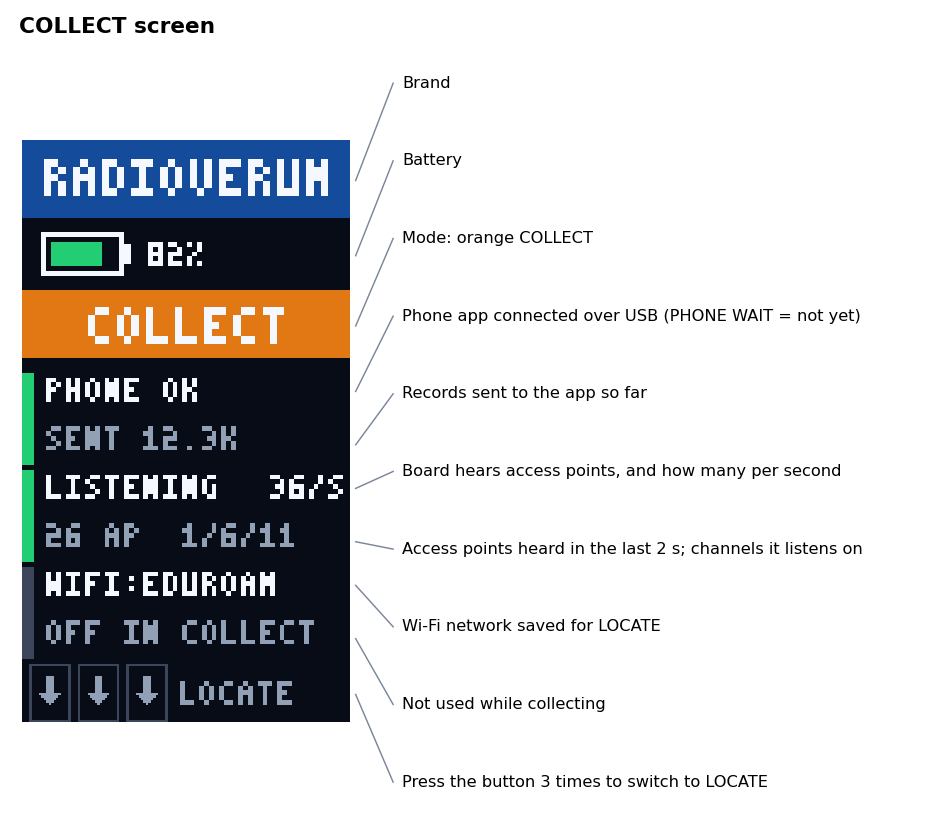

In COLLECT the board does not use Wi-Fi; the bottom block shows your network as `OFF IN COLLECT`.

---

## 7. Update the firmware

**Boards that show 1.5.0 or lower cannot update this way** (the screen shows `UPDATE FAILED`): [flash 1.5.1 over USB](#71-flash-it-yourself-usb) once. From 1.5.1 on it works as below.

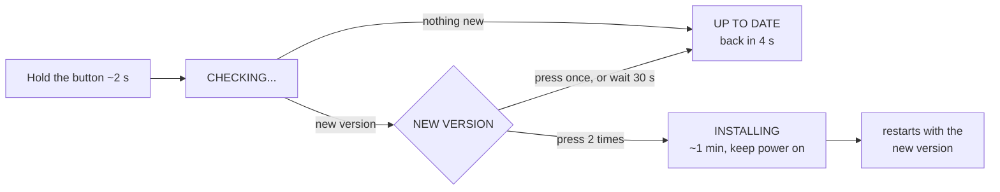

- It works in **either mode**, once Wi-Fi is set up. In COLLECT the board restarts once to join Wi-Fi (`UPDATE CHECK · RESTARTING`), checks, and goes back to COLLECT by itself.
- Right after a start or mode switch it shows `JOINING WIFI` and checks as soon as it is online.
- While installing, do not press anything. The board restarts in the mode it was in, and the boot screen shows the new version.

| | | | | |
|:-:|:-:|:-:|:-:|:-:|
| 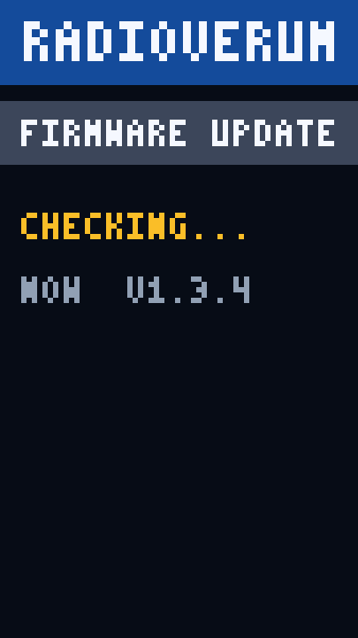<br/>checking | 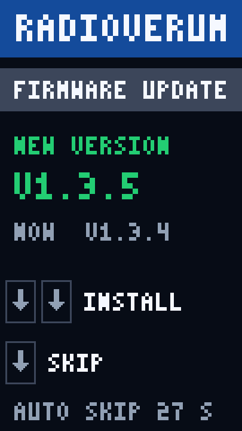<br/>new version | 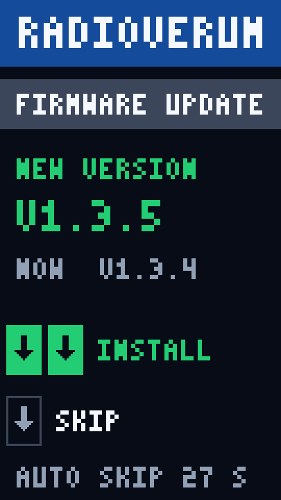<br/>2 presses = install | 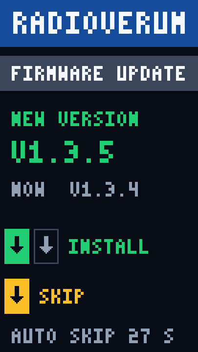<br/>1 press = skip | 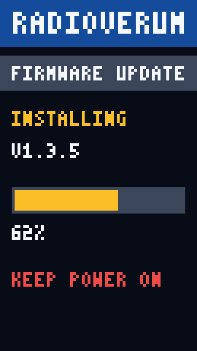<br/>installing |

**Is it safe?** The board downloads updates only from our release page on GitHub, over an encrypted (HTTPS) connection. If the new version does not start properly, or the power is cut, it goes back to the old one by itself. Your settings stay.

### 7.1 Flash it yourself (USB)

For a new board, one that no longer starts, or one that shows 1.5.0 or lower. No account or key is needed. You need the board, a USB-C **data** cable, and a computer with Chrome or Edge.

1. Download `radioverum-sticks3-<version>-full.bin` from <https://github.com/Radio-Atlas/radioverum-firmware/releases/latest>.
2. Plug the board into the computer. Hold the **power button** (on the side) until the green LED blinks, then let go. The board is now in download mode; the screen may go dark.
3. Open <https://espressif.github.io/esptool-js/>. Leave Baudrate at `921600`, click **Connect**, and pick the board (`USB JTAG/serial debug unit` or `ESP32-S3`).
4. Under **Program**: Flash Address `0x0`, choose the `-full.bin` file, click **Program**. Wait about a minute until it says done.
5. Press the power button once. The board starts and shows the version.
6. Do the [first setup](#3-first-setup): flashing erased the Wi-Fi settings. (A way to keep them: [README](https://github.com/Radio-Atlas/radioverum-firmware#keep-the-wi-fi-settings-optional).)

With Python instead of a browser (replace `COM5` with your port; on macOS `/dev/cu.usbmodem…`, on Linux `/dev/ttyACM0`):

```bash
pip install esptool
python -m esptool --chip esp32s3 -p COM5 -b 921600 --before no_reset --after watchdog_reset write_flash 0x0 radioverum-sticks3-1.5.1-full.bin
```

---

## 8. If something is wrong

| What you see | What to do |
|---|---|
| Screen dark | Charge it. If it stays dark, unplug and plug in again |
| 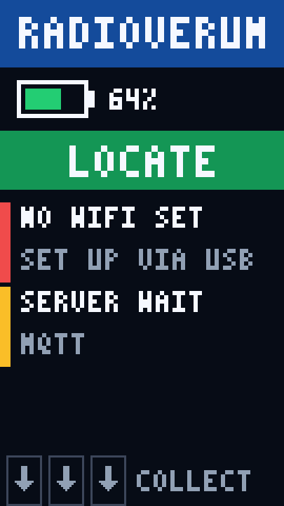<br/>`NO WIFI SET` | Do the [first setup](#3-first-setup) |
| <br/>`JOINING` for over a minute | Wrong username or password, or no 2.4 GHz network. Check the settings, or try a phone hotspot |
| 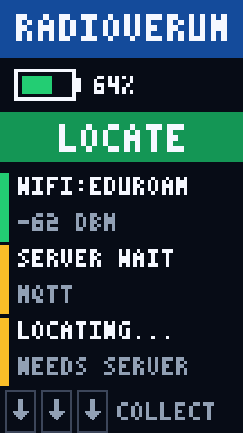<br/>`SERVER WAIT` | The network blocks the connection, or our server is down. Try a hotspot, and tell us |
| `LOCATING...` never ends | Server problem: tell us |
| Position clearly wrong | You may be outside the mapped area. Walk a little; the first seconds are rough |
| Screen dark right after flashing | Press the power button once |
| No port to pick when flashing | Use a data cable (some only charge), and hold the power button again until the green LED blinks |
| `CHECK FAILED · NO WIFI` or `NO CONNECTION` | No Wi-Fi or no Internet right now. Try later, or on a hotspot |
| `UPDATE FAILED …` | The old firmware is kept. On 1.5.0 or lower: [flash 1.5.1 over USB](#71-flash-it-yourself-usb). On 1.5.1 or higher: try later; if it repeats, tell us the reason shown |
| `192.168.7.1` does not open | The cable must be plugged into the phone. Use Safari and type the address exactly |
| Settings page says *403* | You opened it over Wi-Fi. Settings only work over the USB cable |

When you contact us, a photo of the screen helps.

---

## 9. Questions

**What does the board send?** In LOCATE: the signal strengths and identifiers (BSSIDs) of the Wi-Fi access points it hears, about 40 a second, plus its own status. It does not see your phone's traffic, and has no camera or microphone. In COLLECT it sends nothing over Wi-Fi.

**Who can read my data?** It goes through a public relay on the Internet (an MQTT broker) and is **not encrypted**. Anyone who knows our topic name can read what the board sends (Wi-Fi signal readings and your position) and could send it a wrong position. Do not use the board where that matters.

**Where is my eduroam password?** Only on the board, entered by you over USB. The page never shows it again. Before you give the board away, tap **Forget saved settings** on the settings page.

**Can someone change my board over Wi-Fi?** No. Settings and restarts are only accepted over the USB cable.

**Does it work at another school, or at home?** Yes, on any 2.4 GHz network with Internet. Positions only make sense where we have a map.

**Which firmware do I have?** It is on the boot screen (e.g. `V1.5.1`). Holding the button tells you if there is a newer one.
